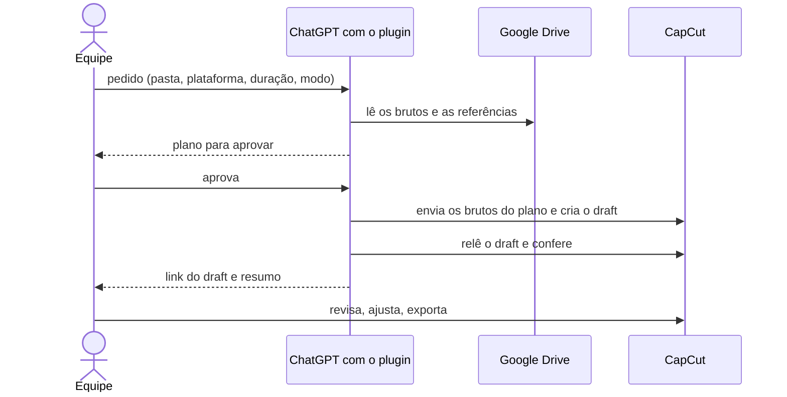

# Soma Digital — plugin de edição

Plugin para o ChatGPT/Codex desktop que ajuda a equipe da Soma Digital a editar vídeos sociais (Reels, vertical 9:16). Quem usa coloca os brutos numa pasta do Drive, descreve o pedido em linguagem natural e recebe um **draft editável no CapCut**, pronto para revisar. Feito pela [Arethos](https://github.com/arethos-tech).

Status: MVP em validação. O fluxo e a instalação abaixo ainda estão sendo testados do ponto de vista de quem vai usar.

## Fluxo de uso


Quem faz o quê em cada conversa:



A skill `trends` também funciona sozinha: pedido de tendências, consulta das fontes, até 3 sugestões com fonte, data e aplicação ao job.

## Etapas em detalhe

| Etapa | O que faz | Lê | Produz |
|---|---|---|---|
| Conferir | Verifica se Google Drive e CapCut estão habilitados | conectores da conversa | aviso e parada se faltar um |
| 1. Novo job (`novo-job`) | Conversa guiada em 3 blocos: cliente (segmento, subnicho, oferta, público, tom), pedido (pastas, plataforma, duração, modo, música) e conferência dos brutos e das referências achados no Drive, inclusive em subpastas | o que quem usa disse, Drive | ficha do cliente e pedido confirmados |
| 2. Planejar (`editar-video`) | Examina brutos e referências, registra só o que observou, consulta o conhecimento e pode sugerir gancho e efeitos | Drive, `references/`, `trends` | plano curto: formato, trechos, timeline, música, texto e, no máximo, uma dúvida |
| Aprovação | Quem usa aprova ou pede ajuste; a aprovação cobre o envio dos brutos ao CapCut | plano | sinal para editar |
| 3. Editar | Cria uma versão recuperável do draft e aplica só o plano aprovado | plano | draft no CapCut |
| 4. Verificar | Relê o draft e confere mídia, ordem, duração, proporção, texto e áudio | draft | link e resumo; prévia só se foi gerada |
| Revisão humana | Ajustes, exportação e publicação ficam com quem usa | draft | decisão |

## Modos de entrega

Cada pedido usa um único modo.

| Modo | Resultado | Cuidados |
|---|---|---|
| `corte-musical-produto` | Sequência de clipes reais cortada pelo ritmo da música | marcar as batidas antes de cortar; tratar o áudio original dos brutos; gancho nos primeiros segundos |
| `template-tela-dividida` | Dois espaços de vídeo, cada um com duração e enquadramento independentes | ajustes de um lado não alteram o outro; definir o que ocorre quando um clipe acaba antes |

## Conhecimento que o plugin consulta

| Arquivo | Conteúdo | Estado |
|---|---|---|
| `references/modos.md` | os dois modos e seus cuidados | pronto |
| `references/repertorio.md` | transições, efeitos visuais e efeitos sonoros usados | pronto; falta ligar cada item ao efeito equivalente no CapCut |
| `references/biblioteca.md` | templates, ganchos e estruturas com evidência | vazio; só entra o que for testado |
| skill `trends` | o que está em alta e, para clientes de nicho específico, anúncios do nicho | pronto |

## Regras fixas

- Nunca publica. Preserva os originais do Drive.
- Usa só os brutos do pedido: sem banco de imagens, mídia gerada ou imagem genérica.
- Não inventa texto, chamada para ação nem logo; não exporta o vídeo final sem pedido.
- Respeita o que já foi alterado no CapCut por quem usa.

## Instalar

Requisitos: app desktop do ChatGPT, plugin oficial do [CapCut](https://www.capcut.com/tools/capcut-x-codex) instalado e autorizado, e o conector do Google Drive habilitado.

```bash
codex plugin marketplace add arethos-tech/soma-digital-plugin
```

Reinicie o app, abra o diretório de plugins, escolha o marketplace "Soma Digital" e instale.

## Usar

Quem usa só grava e coloca os vídeos no Drive; o plugin guia o resto. Abra uma conversa nova e diga o que quer, por exemplo:

> Quero criar um vídeo novo para um cliente.

A skill `novo-job` pergunta, em até 3 blocos curtos, sobre o cliente, o pedido e as pastas, confere o que achou no Drive e segue para o plano. Quem já sabe o que quer pode mandar tudo de uma vez:

> Cliente: loja de moda feminina, público jovem, tom descontraído; destaque: coleção nova. Brutos na pasta Agência e referências na pasta Ref. Reels de 15 segundos para Instagram, corte musical de produto. Me mostra o plano antes de editar.

## Estrutura do repositório

```
.agents/plugins/marketplace.json     catálogo para instalar pelo Codex
plugin/plugin.json                   manifesto
plugin/skills/novo-job/              início guiado (cliente, pedido, pastas)
plugin/skills/editar-video/          plano, edição e verificação (SKILL.md) e references/
plugin/skills/trends/                tendências e anúncios do nicho
```

Não há vídeos, links de Drive nem dados pessoais neste repositório.
